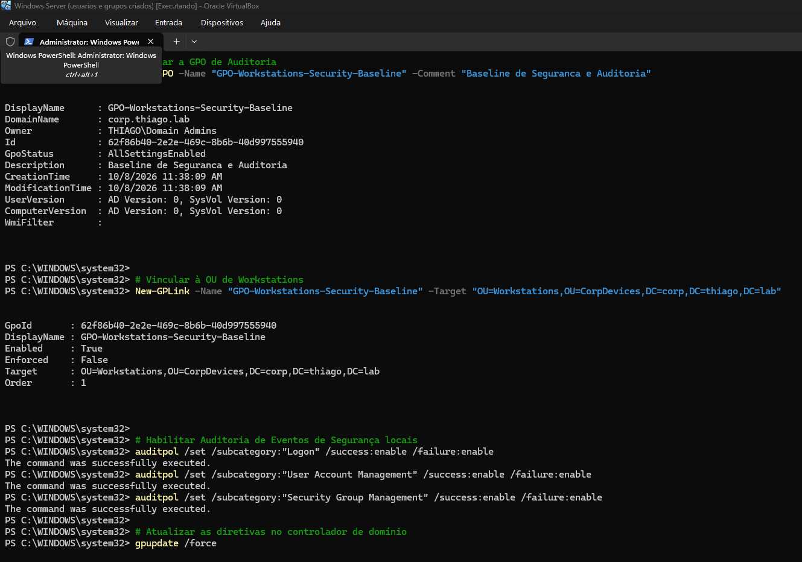
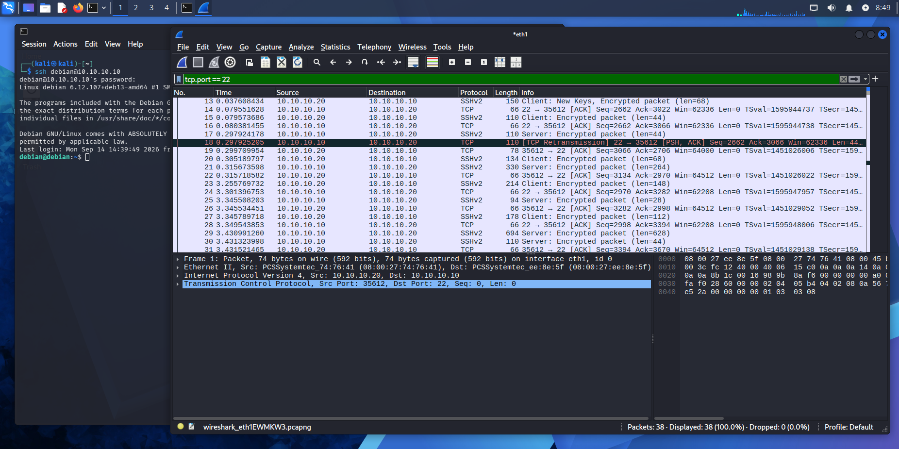

# 🛡️ Thiago Souza Silva | Cybersecurity & SOC Analyst Portfolio

---

## 👨‍💻 Sobre Mim

Profissional em transição de carreira de **Suporte Local N2** para **Análise de Cibersegurança / Operações SOC (Blue Team)**. Graduando em **Segurança da Informação**, utilizo minha sólida experiência prática em suporte, administração de sistemas Windows/Linux e infraestrutura de rede para construir soluções defensivas e conduzir análises de segurança baseadas em evidências.

- 🎓 **Formação:** Graduando em Segurança da Informação
- 📜 **Certificações & Cursos:** Google Cybersecurity Professional Certificate, Cisco Networking Academy, Solyd Pentest 2.0, FIAP Cloud Fundamentals
- 🎯 **Foco Principal:** Monitoramento de Segurança (SOC), Segurança em Active Directory, Análise de Tráfego de Rede e Higiene de Identidades (IAM).

---

## ⚡ Destaques & Evidências Visuais (Highlights)

> *Evidências práticas extraídas dos ambientes de laboratório no CyberLab.*

| Windows Server 2025 & Active Directory | Análise de Tráfego com Wireshark |
| :---: | :---: |
|   *Criação de GPO `GPO-Workstations-Security-Baseline`, vínculo na OU e configuração de auditoria via PowerShell* |   *Captura e inspeção de pacotes SSH (`tcp.port == 22`) entre Kali e Debian no Wireshark* |

---

## 🚀 Projetos Principais

Uma visão estruturada dos principais projetos desenvolvidos para demonstrar competências práticas em segurança defensiva, dados e desenvolvimento de software:

### 🎯 1. Cybersecurity Roadmap & CyberLab (Projeto Principal)
* **Problema:** Necessidade de simular um ambiente corporativo real para praticar defesa em profundidade, detecção de ameaças e hardening.
* **Solução:** Implementação de um laboratório virtualizado (**CyberLab**) contendo Kali Linux, Debian e **Windows Server 2025** como Controlador de Domínio (AD CS, DNS, OUs, GPOs) e máquina cliente Windows.
* **Resultado Validado:** 
  - Estruturação completa do Active Directory e aplicação validada de políticas de segurança (GPOs) via `gpresult /r`.
  - Mapeamento e análise de tráfego de rede (ARP, DNS, ICMP) e varreduras com Nmap e Wireshark.
* 🔗 [Ver Repositório Completo](https://github.com/thiagoalphabsb/Cybersecurity-Roadmap)

---

### 🔑 2. Account Security Hygiene
* **Problema:** Vulnerabilidade a ataques de engenharia social, credential stuffing e acessos indevidos por falhas de higiene cibernética.
* **Solução:** Framework prático de higiene de acessos e identidade, cobrindo implementação de MFA/2FA, gerenciadores de senhas, auditoria de sessões ativas e matriz de risco para 9 escopos de contas.
* **Resultado Validado:** Redução demonstrada do nível de risco residual e criação de procedimentos reproduzíveis de auditoria de IAM.
* 🔗 [Ver Repositório Completo](https://github.com/thiagoalphabsb/account-security-hygiene)

---

### 📊 3. Power BI & Análise de Dados Públicos (CNES / SIH-SUS)
* **Problema:** Necessidade de transformar dados brutos de saúde pública em indicadores executivos e operacionais inteligíveis.
* **Solução:** Pipeline ETL em Power Query, modelagem dimensional em estrela (Star Schema) e métricas avançadas em DAX com base em dados reais do SUS.
* **Resultado Validado:** Dashboards interativos respondendo a perguntas estratégicas sobre capacidade hospitalar e fluxo de internações.
* 🔗 [Ver Repositório Completo](https://github.com/thiagoalphabsb/Power-BI-Roadmap)

---

### 📱 4. THUNDER-FIT-APP
* **Problema:** Acompanhamento descentralizado e ineficiente de rotinas de treino e progressão de carga.
* **Solução:** Aplicação Web/PWA desenvolvida em React, TypeScript, Tailwind CSS e Firebase, contando com regras de acesso estruturadas no Firestore e assistente integrado por IA.
* **Resultado Validado:** PWA funcional com armazenamento local/offline, regras de segurança validadas no backend e interface responsiva.
* 🔗 [Ver Repositório Completo](https://github.com/thiagoalphabsb/THUNDER-FIT-APP)

---

## 🛠️ Competências Técnicas

**Sistemas & Redes**  

**Segurança Defensiva & Análise**  

**Scripting & Dados**  

---

## 📬 Contato & Conexão

Estou aberto a oportunidades profissionais em **Análise de Cibersegurança / SOC Júnior**, **Suporte Técnico N2/N3** e **Segurança da Informação**.

- **LinkedIn:** [linkedin.com/in/thiago-souza-silva](https://www.linkedin.com/in/thiago-souza-silva-5607223aa/)
- **GitHub:** [github.com/thiagoalphabsb](https://github.com/thiagoalphabsb)
- **Localização:** Brasília, DF - Brasil

